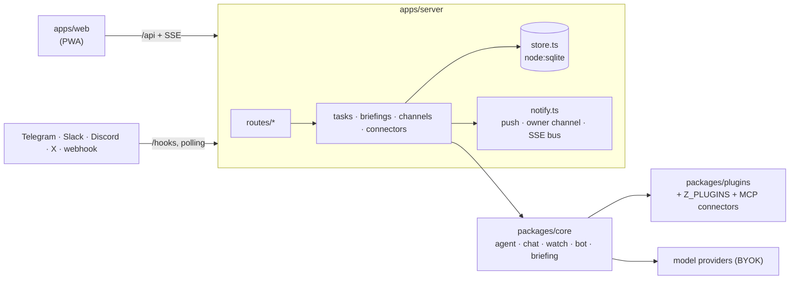

# Architecture

This page explains how z is put together so you know where a change belongs: the packages and their boundaries, how each kind of run flows, how data is stored and migrated, and which file to open for what.

## Packages

```
packages/core      contract.ts (every shared type and route), plugin.ts (plugin API), the runtime:
                   providers, tools + approvals, agent, chat, watch, bot, briefing, memory, context
packages/plugins   built-in plugins: web, browser, rss, github, clock, channels (webhook, telegram,
                   slack, discord, x); the SSRF guard
apps/server        Hono + node:sqlite: HTTP routes, store, sealer, task engine, scheduler,
                   channel runtime, connectors (MCP), notices and Web Push
apps/web           React 19 PWA (Base UI, Tailwind v4, lucide); talks to the server only over /api
```

Boundaries:

- **`contract.ts` is the only shared vocabulary.** Anything that crosses a package or process boundary (HTTP bodies, live events, plugin manifests) is defined there first, then implemented on both sides.
- **`core` has no I/O of its own.** Each run gets its dependencies passed in: the model resolver, routing, settings, active plugins and memory recall. It never touches SQLite, env vars or HTTP routes, so the server and the tests (`apps/server/test/harness.ts`) wire it the same way.
- **`plugins` depend on `core`'s plugin API only.** The server adds the plugins it owns (`memory`, which needs the store, and `tasks`, whose `tasks_watch` tool starts a watch from a conversation) and the ones named in `Z_PLUGINS`. MCP connectors are wrapped as plugins too (`connectorPlugin`), so no run needs a special case for them.
- **`web` depends on `core` for types only**, and calls the API like any client.
- Packages are consumed as TypeScript source; there is no build step except the web bundle. The server runs through `tsx`.



## Providers and lanes

`providers.ts` turns a `ProviderConfig` into an AI SDK model for `openai`, `anthropic`, `google`, `xai`, `openrouter`, `ollama`, `openai-compatible` and `codex-cli`. Routing maps each lane (`chat`, `agent`, `briefing`, `bot`, `fast`) to an ordered list of `providerId:modelId`. A lane's chain moves to the next model on errors that allow fallback. A model that answered "retry after N" is skipped until then, and when every model in a lane is cooling down, z waits once (free tiers ask for about 30 s). Background work (tasks, briefings) checks each provider's monthly budget first. An empty `fast` lane falls back to `agent`.

Anthropic models are API-key only: Anthropic forbids third-party products from using Claude Pro/Max subscription credentials.

### `codex-cli`

The `codex-cli` provider (`packages/core/src/codex.ts`) runs z on a ChatGPT plan through the official Codex CLI, installed and signed in (`codex login`) on the server's machine. OpenAI hasn't published terms for third-party apps using ChatGPT plans, so check that this use is acceptable to you before relying on it.

- z talks only to `codex app-server` (JSON-RPC over stdio), which owns sign-in. z stores no key, base URL or headers for this provider, and never reads Codex credentials. `command` can set an absolute path to the binary. Without it, z uses `codex` on `PATH`, then the copy installed with z.
- Each model call is one Codex turn in a short-lived thread that z fills with the conversation. z's tools are offered as Codex dynamic tools, so every call still goes through z's guard, safety floor, policy, reviewer and approvals.
- Codex's own shell, file, MCP and web tools are turned off, its sandbox is read-only in an empty temporary directory, every approval Codex asks for is declined, and a built-in tool that runs anyway stops the turn.
- The Codex process gets no `Z_*` variables and no variables whose names look like keys, tokens, secrets or passwords.
- `POST /api/providers/:id/test` reports the sign-in (`account`), and fails with "Codex CLI is not signed in — run `codex login` on this server's machine" until you do. Usage is recorded at $0.

## Run flows

Every run builds its tool set with `buildTools` (`core/src/tools.ts`). It applies the policy, drops denied tools, and wraps each `execute` with the sensitive-data guard. It also returns the `toolApproval` function the AI SDK calls before each tool runs: safety floor, then policy, then reviewer ([security](security.md#approvals)).

**Chat.** `POST /api/chat` → `routes/chat.ts` → `core/chat.ts streamChat` with owner dependencies (memory included). It streams the AI SDK UI message stream, fits the prompt into the model's window (`context.ts`, with a cached summary per thread), and pauses on tool approvals inside the stream; the web app answers them and resends. The thread is saved when the response ends.

**Task.** `POST /api/tasks` → `tasks.ts create` → queue (2 at a time) → `core/agent.ts runTask` (up to 12 steps). The result decides the next state:

- `waiting`: approvals are stored, announced on the bus and sent as notices. `POST /api/approvals/:id` appends the AI SDK approval responses once all are decided and re-queues the task.
- `needs_input`: the agent called `ask_person`. `POST /api/tasks/:id/answer` appends the answer as that tool's result.
- `review` (one-shot) or `scheduled` (recurring): the run finished.
- `failed`: the run failed or the agent called `report_failure`. Ten failures in a row pause a recurring task.

The conversation is saved after every step, and every `write`/`external` call is journaled before and after it runs (`task_calls`). On startup, `recovery.ts` resumes a task that was `running` from its saved conversation, unless a journaled call has no result. That task becomes `interrupted` and is never replayed. Schedules are cron (croner) in `Settings.timezone`. A recurring run that fell due while z was down runs once at startup if it is under 24 hours old (`missedPolicy: "once"`, the default) and is skipped otherwise. A recurring task only notifies on success when its result differs from the last successful run's, or when it ends a failure streak.

A chat message or task that starts with `/<name>` runs with that **skill** (`core/skills.ts`, `/api/skills`): its instructions are added, and its `tools` narrow what the run is offered. A skill never grants a tool that the policy doesn't expose. Without a skill, a run with many connector tools is offered at most 24 of them, picked by matching words in the request.

**Watch.** A task with `mode: "watch"` (hourly when no schedule) → `core/watch.ts runWatch`. It looks with `read` tools only, then a small structured decision on the `fast` lane (then the task's lane) says whether to notify. URLs seen in tool results become fingerprints (up to 1000 kept), and a later check only notifies about things not seen before.

**Bot.** An adapter (`/hooks/:id` or its own connection) → `channels.ts dispatch`: `/link` pairing first, then per-channel and per-author limits, then `core/bot.ts answerMessage` with non-owner dependencies (no memory). It gets public `read` tools plus the provider's own search, a research round within a time budget, and a reply parsed into verdict, text and sources. Only sources a tool returned are kept. The last 20 turns per platform thread live in `bot_memory`.

**Briefing.** The `Settings.briefingCron` timer or `POST /api/briefing` → `briefings.ts` → `core/briefing.ts`. Plugin briefing sources and open tasks give the items; failing sources are listed as "could not check". `core/triage.ts` sorts the items into `needs_you` or `can_wait`. Source signals settle some with no model call, and the `briefing` model reads the rest. With a `briefing` lane model, the summary, follow-up suggestions and up to 3 proposed tasks also come back as structured output. Without one, unsorted items show as needing you and the summary is a plain count.

**Notices.** Approvals, questions, watch hits, finished tasks, briefings and memory reviews all go through `notify.ts`. Each notice is stored and emitted on the bus (`/api/events`), with one delivery per Web Push device and one for the paired owner channel, all stored before anything is sent. Failed deliveries retry after 30 s, 2 min, 10 min, 1 h and 6 h, and are marked failed after 6 attempts. They survive restarts, and they are dropped once their approval is decided or their question answered. Channel messages carry buttons only when the whole preview fits. Adapters that can edit rewrite sent messages to show the outcome.

## Storage

One SQLite file, `Z_DATA_DIR/z.db`, opened with WAL, foreign keys and a 5 s busy timeout (`db.ts`). `store.ts` is the only module that runs SQL. Secrets go through the sealer (`crypto.ts`, AES-256-GCM with the master key) on the way in and out, and are registered with the log redactor (`secrets.ts`).

**Migrations** are an append-only array of named entries (`{ id: "NNNN-name", sql }`) in `db.ts`. At startup, every one not yet recorded in `schema_migrations` runs in its own transaction and is recorded. `PRAGMA user_version` keeps the count, and databases from before named migrations are adopted from it. To change the schema, append an entry with the next number; never edit, rename or reorder one that has shipped. `apps/server/test/migrations.test.ts` covers upgrades from older versions.

## Where to change what

| To… | Change |
| --- | --- |
| Add or change an API route or shared type | `packages/core/src/contract.ts` first, then `apps/server/src/routes/*` and `apps/web/src/api/*` |
| Add a tool, briefing source or channel adapter | A plugin ([plugins](plugins.md)); built-ins in `packages/plugins/src/*` |
| Add a chat platform | `ChannelKind` in `contract.ts`, then an adapter in `packages/plugins/src/channels/` |
| Change approval rules | `packages/core/src/approvals.ts` (floor, preview, reviewer), `tools.ts` (gates), `sensitive.ts` (guard) |
| Change agent, chat, watch, bot or briefing behaviour | The matching file in `packages/core/src/`; briefing triage in `triage.ts`, skills and tool narrowing in `skills.ts` |
| Add a model provider kind | `ProviderKind` in `contract.ts`, then `packages/core/src/providers.ts` |
| Task lifecycle, schedules, crash recovery | `apps/server/src/tasks.ts`, `recovery.ts`, `schedule.ts` |
| Connectors, MCP transport, OAuth | `packages/core/src/connectors.ts` (presets, risk mapping), `apps/server/src/connectors.ts`, `oauth.ts` |
| Schema | Append to `MIGRATIONS` in `apps/server/src/db.ts`; queries in `store.ts` |
| Env vars and startup | `apps/server/src/env.ts`, `main.ts` |
| Setup checklist rows | `apps/server/src/setup.ts` |
| A screen in the app | `apps/web/src/routes/*`, settings panels in `apps/web/src/settings/panels/*`, using the `apps/web/src/ui` wrappers |

Checks before sending a change: `pnpm typecheck`, `pnpm test`, `pnpm --filter @z/web build` (CI runs the same, plus a Docker build).
